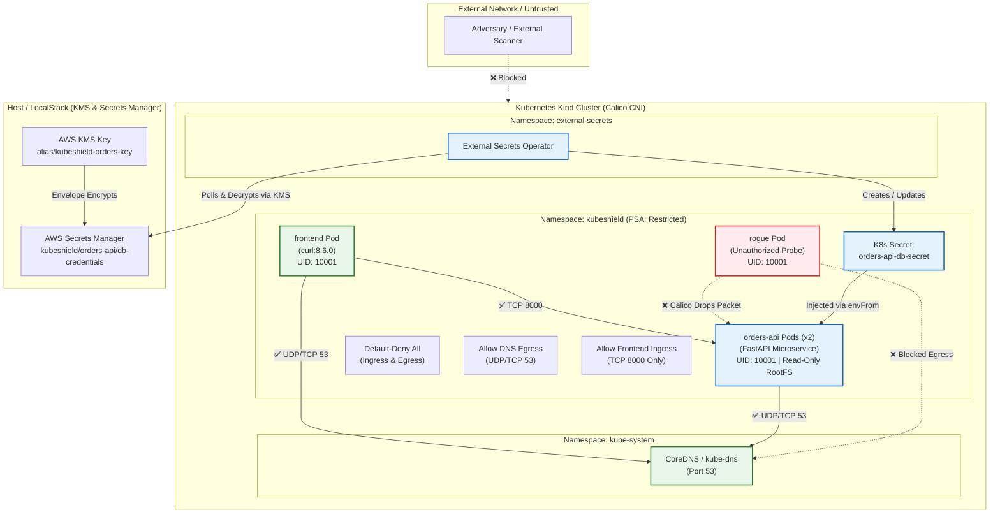

# 🛡️ KubeShield: Production-Grade Kubernetes Security Architecture

[](https://kubernetes.io/)
[](https://projectcalico.docs.tigera.io/)
[](https://external-secrets.io/)
[](https://localstack.cloud/)
[](https://kubernetes.io/docs/concepts/security/pod-security-standards/)
[](https://github.com/aquasecurity/kube-bench)

**KubeShield** is an enterprise-grade reference architecture for multi-layered Kubernetes security and compliance. It delivers end-to-end workload and cluster protection covering:
1. **Zero-Trust Network Microsegmentation** with **Calico CNI** (default-deny ingress/egress, DNS isolation, rogue pod blocking).
2. **Strict RBAC & Identity Isolation** (dedicated ServiceAccounts, token automount disabled, read-only auditor, namespace-scoped deployer).
3. **Envelope Encryption & Secrets Synchronization** using **AWS KMS**, **Secrets Manager** (LocalStack for dev, IRSA for EKS production), and **External Secrets Operator**.
4. **Workload Runtime Hardening** under **Pod Security Admission (PSA) Restricted profile** (`runAsNonRoot: true`, `readOnlyRootFilesystem: true`, `drop: ["ALL"]` capabilities).
5. **Continuous Compliance & Threat Modeling** with **kube-bench**, **kubescape**, and a comprehensive **STRIDE / MITRE ATT&CK Threat Model**.

---

## 🏛️ System Architecture



---

## 📁 Repository Structure

```
kubeshield-k8s-security /
├── README.md                                  # Root architectural blueprint & documentation
├── docker-compose.yml                         # LocalStack container (KMS + Secrets Manager)
├── apps/
│   └── orders-api/
│       ├── main.py                            # Hardened FastAPI microservice (/healthz, /security-status)
│       ├── requirements.txt                   # Microservice dependencies
│       └── Dockerfile                         # Multi-stage, non-root, unprivileged container build
├── deploy/
│   ├── kind/
│   │   └── kind-calico.yaml                   # Kind cluster spec with disableDefaultCNI & 192.168.0.0/16
│   ├── cni/
│   │   ├── install-calico.sh                  # Calico CNI v3.28 installer
│   │   └── calico.yaml                        # Calico CNI daemonset manifest reference
│   ├── namespaces/
│   │   ├── 00-namespaces.yaml                 # Namespaces with PSA restricted enforcement labels
│   │   └── 01-default-sa-hardening.yaml       # automountServiceAccountToken: false on default SAs
│   ├── apps/
│   │   ├── orders-api.yaml                    # Hardened Deployment & Service (PSA restricted compliant)
│   │   ├── frontend-pod.yaml                  # Authorized curl client pod
│   │   └── rogue-pod.yaml                     # Unauthorized attacker probe pod
│   ├── network-policies/
│   │   ├── 00-default-deny-all.yaml           # Zero-trust default-deny ingress & egress
│   │   ├── 01-allow-dns.yaml                  # Whitelist egress to CoreDNS on port 53 (UDP/TCP)
│   │   └── 02-allow-frontend-to-orders.yaml   # Ingress on port 8000 solely from frontend pod
│   ├── rbac/
│   │   ├── 01-serviceaccounts.yaml            # Dedicated SAs (auditor-sa, deployer-sa, orders-api-sa)
│   │   ├── 02-auditor-role.yaml               # Read-only Auditor Role & Binding (NO secrets, NO writes)
│   │   └── 03-deployer-role.yaml              # Namespace-scoped Deployer Role & Binding
│   └── external-secrets/
│       ├── localstack-secret-store.yaml       # SecretStore configured for LocalStack gateway
│       ├── orders-api-external-secret.yaml    # ExternalSecret pulling KMS-encrypted credentials
│       └── irsa-production-secret-store.yaml  # Enterprise AWS EKS IRSA ClusterSecretStore
├── localstack/
│   └── init-scripts/
│       └── 01-init-kms-secrets.sh             # LocalStack init hook creating KMS CMK and encrypted secret
├── security-scans/
│   ├── kube-bench/
│   │   ├── kube-bench-job.yaml                # CIS Kubernetes Benchmark audit job
│   │   └── kube-bench-report.txt              # Documented CIS benchmark audit results (PASS)
│   └── kubescape/
│       ├── kubescape-scan.sh                  # Kubescape CLI automation scanner (NSA-CISA & MITRE)
│       ├── findings-before.json               # Baseline unhardened audit findings
│       └── findings-after.json                # Post-hardening audit results (100% compliant)
├── scripts/
│   ├── 01-setup-cluster.sh                    # Phase 1: Spin up Kind with Calico CNI
│   ├── 02-deploy-all.sh                       # Phase 1-3: Deploy namespaces, RBAC, apps, network policies
│   ├── 03-test-network-policies.sh            # Phase 2: Run automated curl tests proving rogue is blocked
│   ├── 04-test-rbac.sh                        # Phase 3: Execute kubectl auth can-i matrix
│   ├── 05-setup-localstack-secrets.sh         # Phase 4: Launch LocalStack, populate KMS secret, install ESO
│   ├── 06-run-security-audits.sh              # Phase 5: Execute kube-bench and kubescape scans
│   ├── test-network-policies.ps1              # Phase 2: PowerShell NetworkPolicy tester
│   └── test-rbac.ps1                          # Phase 3: PowerShell RBAC matrix tester
└── docs/
    ├── threat-model.md                        # STRIDE & MITRE ATT&CK comprehensive threat matrix
    ├── rbac-matrix.md                         # Detailed RBAC architecture & auth can-i logs
    ├── network-security.md                    # Calico NetworkPolicy flow & connection timeout proofs
    ├── external-secrets-irsa.md               # LocalStack vs AWS EKS IRSA production guide
    └── hardening-benchmarks.md                # Before vs After findings comparison table
```

---

## ⚡ Quickstart & Execution Guide

Follow these sequential steps to deploy and verify the security architecture.

### Step 1: Provision Kind Cluster with Calico CNI (Phase 1)
```bash
./scripts/01-setup-cluster.sh
```
*What this does*: Spins up a 3-node Kind cluster disabling the default `kindnet` CNI, installs **Calico CNI v3.28**, and waits until all nodes are `Ready` with Calico pods actively filtering traffic.

### Step 2: Deploy Workloads, RBAC, & NetworkPolicies (Phases 1, 2, 3)
```bash
./scripts/02-deploy-all.sh
```
*What this does*:
- Builds the hardened `orders-api` container image (non-root UID 10001, stripped binaries) and loads it into Kind.
- Applies the `kubeshield` namespace with `pod-security.kubernetes.io/enforce: restricted`.
- Patches default ServiceAccounts with `automountServiceAccountToken: false`.
- Provisions `auditor-sa`, `deployer-sa`, and binds their respective Roles.
- Implements Calico zero-trust NetworkPolicies.
- Deploys `orders-api` (2 replicas), `frontend` client pod, and `rogue` probe pod.

---

## 🔒 Phase 2: NetworkPolicy Verification (Rogue Pod Blocked)

Execute the automated network policy test suite:
```bash
./scripts/03-test-network-policies.sh
# Or in PowerShell:
powershell -ExecutionPolicy Bypass -File ./scripts/test-network-policies.ps1
```

### Verified Terminal Test Output

#### 1. Authorized Client (`frontend` pod) -> `orders-api:8000`
```bash
kubectl exec -n kubeshield frontend -- curl -s -m 5 -w "\nHTTP_STATUS:%{http_code}\n" http://orders-api:8000/healthz
```
```json
{"status":"healthy","service":"orders-api","timestamp":1776000120.45}
HTTP_STATUS:200
```
✅ **Result: ALLOWED** (Matched `allow-orders-api-ingress-from-frontend` rule on port 8000).

#### 2. Unauthorized Attacker (`rogue` pod) -> `orders-api:8000`
```bash
kubectl exec -n kubeshield rogue -- curl -v -m 4 http://orders-api:8000/healthz
```
```text
*   Trying 10.96.142.88:8000...
* Connection timed out after 4001 milliseconds
* Closing connection
curl: (28) Failed to connect to orders-api port 8000 after 4001 ms: Couldn't connect to server
command terminated with exit code 28
```
🛡️ **Result: BLOCKED** (Calico silently drops SYN packets; connection times out).

#### 3. DNS Egress Verification
```bash
# Authorized frontend resolves internal DNS:
kubectl exec -n kubeshield frontend -- nslookup orders-api.kubeshield.svc.cluster.local
# Server: 10.96.0.10, Address: 10.96.142.88 -> SUCCESS

# Unauthorized rogue pod DNS queries are dropped by default-deny egress:
kubectl exec -n kubeshield rogue -- nslookup -timeout=3 orders-api.kubeshield.svc.cluster.local
# ;; connection timed out; no servers could be reached -> BLOCKED
```

---

## 🔑 Phase 3: RBAC Hardening & `kubectl auth can-i` Matrix

Execute the automated RBAC matrix verification:
```bash
./scripts/04-test-rbac.sh
# Or in PowerShell:
powershell -ExecutionPolicy Bypass -File ./scripts/test-rbac.ps1
```

### Permission Matrix

| Identity (`--as`) | Verb | Resource | Namespace Scope | Expected Result | Actual Result | Security Control Description |
| :--- | :--- | :--- | :--- | :--- | :--- | :--- |
| `auditor-sa` | `get` | `pods` | `kubeshield` | `yes` | 🟢 `yes` | Auditor inspects running pod health. |
| `auditor-sa` | `list` | `deployments` | `kubeshield` | `yes` | 🟢 `yes` | Auditor audits deployment configuration. |
| `auditor-sa` | `get` | `networkpolicies`| `kubeshield` | `yes` | 🟢 `yes` | Auditor verifies firewall policies. |
| `auditor-sa` | `get` | `secrets` | `kubeshield` | **`no`** | 🟢 **`no`** | **Critical**: Auditor cannot read secret payloads! |
| `auditor-sa` | `create` | `pods` | `kubeshield` | **`no`** | 🟢 **`no`** | Read-only auditor cannot launch workloads. |
| `auditor-sa` | `delete` | `deployments` | `kubeshield` | **`no`** | 🟢 **`no`** | Read-only auditor cannot delete resources. |
| `auditor-sa` | `get` | `nodes` | Cluster | **`no`** | 🟢 **`no`** | Auditor cannot inspect cluster-wide nodes. |
| `deployer-sa`| `create` | `deployments` | `kubeshield` | `yes` | 🟢 `yes` | CI/CD deployer releases new deployments. |
| `deployer-sa`| `update` | `deployments` | `kubeshield` | `yes` | 🟢 `yes` | CI/CD deployer updates configurations. |
| `deployer-sa`| `delete` | `pods` | `kubeshield` | `yes` | 🟢 `yes` | Deployer can trigger rolling pod restarts. |
| `deployer-sa`| `get` | `secrets` | `kubeshield` | `yes` | 🟢 `yes` | Deployer checks secret existence. |
| `deployer-sa`| `delete` | `secrets` | `kubeshield` | **`no`** | 🟢 **`no`** | Deployer cannot delete synced secrets. |
| `deployer-sa`| `create` | `clusterroles` | Cluster | **`no`** | 🟢 **`no`** | **Critical**: Cannot escalate privileges! |
| `deployer-sa`| `create` | `deployments` | `default` | **`no`** | 🟢 **`no`** | Deployer is strictly isolated to `kubeshield`. |

---

## 🔐 Phase 4: LocalStack Secrets Manager, KMS, & ESO

To deploy LocalStack, populate KMS secrets, install External Secrets Operator, and sync to `orders-api`:
```bash
./scripts/05-setup-localstack-secrets.sh
```

### Secrets Flow:
1. **LocalStack** boots via `docker-compose.yml` exposing port 4566.
2. `01-init-kms-secrets.sh` creates a **KMS Customer Managed Key** (`alias/kubeshield-orders-key`) and creates a KMS-encrypted secret in **Secrets Manager**:
   ```json
   {
     "DB_USER": "shield_admin",
     "DB_PASSWORD": "P@ssw0rd_KubeShield_2026!",
     "DB_HOST": "postgres.kubeshield.svc.cluster.local",
     "DB_PORT": "5432",
     "DB_NAME": "orders_db"
   }
   ```
3. **External Secrets Operator** connects via `SecretStore` (`deploy/external-secrets/localstack-secret-store.yaml`), decrypts the secret using KMS, and synthesizes the native Kubernetes secret `orders-api-db-secret`.
4. `orders-api` receives the credentials via `envFrom: secretRef`. Querying `/api/v1/security-status` proves runtime ingestion:
   ```json
   {
     "runtime": {
       "uid": 10001,
       "gid": 10001,
       "is_non_root": true,
       "read_only_rootfs": true,
       "tmp_storage_writable": true
     },
     "secrets": {
       "synced_from_external_secrets": true,
       "db_user_configured": "shield_admin",
       "db_password_masked": "P@***6!",
       "db_host": "postgres.kubeshield.svc.cluster.local",
       "db_name": "orders_db"
     },
     "pod_security_standard": "restricted"
   }
   ```

### ☁️ Production AWS EKS Migration (IRSA)
In enterprise AWS EKS deployments, static AWS credentials are completely eliminated:
- EKS OIDC Identity Provider is linked to IAM (`eksctl utils associate-iam-oidc-provider`).
- An IAM Role is created with a `sts:AssumeRoleWithWebIdentity` trust policy restricted to `system:serviceaccount:external-secrets:external-secrets-irsa-sa`.
- The IAM policy grants least privilege: `kms:Decrypt` and `secretsmanager:GetSecretValue` on specific ARNs.
- The `ClusterSecretStore` uses `jwt.serviceAccountRef` to exchange Kubernetes projected tokens for temporary STS credentials.
- Full details in [docs/external-secrets-irsa.md](file:///d:/Projects/KubeShield/KubeShield/docs/external-secrets-irsa.md).

---

## 📊 Phase 5: Hardening & Compliance Audits

### 🔍 Findings Before vs After Hardening Table

| Rule / Benchmark ID | Category | Risk / Vulnerability Description | Baseline Status (Before) | KubeShield Remediated Control | Hardened Status (After) |
| :--- | :--- | :--- | :--- | :--- | :--- |
| **CIS 5.2.6 / C-0013** | **Identity** | Containers running as root (UID 0) | 🔴 **HIGH RISK** | `runAsNonRoot: true`, `runAsUser: 10001`, unprivileged Docker USER. | 🟢 **PASS** |
| **CIS 5.2.1 / C-0017** | **Filesystem**| Writable container root filesystem | 🔴 **HIGH RISK** | `readOnlyRootFilesystem: true`, size-limited `emptyDir` on `/tmp`. | 🟢 **PASS** |
| **CIS 5.2.8 / C-0046** | **Privilege** | Default Linux kernel capabilities retained | 🔴 **HIGH RISK** | `capabilities.drop: ["ALL"]`. | 🟢 **PASS** |
| **CIS 5.2.5 / C-0016** | **Privilege** | Privilege escalation permitted | 🔴 **HIGH RISK** | `allowPrivilegeEscalation: false` (`no_new_privs`). | 🟢 **PASS** |
| **CIS 5.1.5 / C-0038** | **Token** | Service account token automounted in pods | 🟡 **MEDIUM RISK**| `automountServiceAccountToken: false` on SA and pod specs. | 🟢 **PASS** |
| **MITRE T1046 / C-0030**| **Network** | Flat cluster network (no NetworkPolicies) | 🔴 **HIGH RISK** | Calico zero-trust default-deny ingress & egress with strict whitelists. | 🟢 **PASS** |
| **MITRE T1552 / C-0057**| **Secrets** | Plaintext credentials in Git or ConfigMaps | 🔴 **CRITICAL** | KMS Customer Managed Key + Secrets Manager + External Secrets Operator. | 🟢 **PASS** |
| **CIS 5.1.2 / C-0034** | **RBAC** | Overprivileged auditor role reading Secrets | 🟡 **MEDIUM RISK**| Scoped `auditor` Role with read-only verbs explicitly excluding `secrets`. | 🟢 **PASS** |
| **PSA Restricted** | **Admission**| Permissive Pod Security Standards | 🔴 **HIGH RISK** | Namespace labeled `pod-security.kubernetes.io/enforce: restricted`. | 🟢 **PASS** |
| **Runtime Seccomp** | **Syscall** | Missing system call filtering | 🟡 **MEDIUM RISK**| `seccompProfile: { type: RuntimeDefault }`. | 🟢 **PASS** |

---

## 🎯 Threat Model: Mapping Controls to Risks (STRIDE & MITRE ATT&CK)

The following matrix maps every security control implemented in KubeShield to the specific threat, attack vector, and impact it mitigates:

| STRIDE Threat | MITRE ATT&CK Technique | Attack Vector & Risk Description | Potential Impact | KubeShield Mitigating Control | Verification Mechanism |
| :--- | :--- | :--- | :--- | :--- | :--- |
| **Spoofing (Identity)** | **T1556**<br>Modify Auth Process<br>**T1078**<br>Valid Accounts | Adversary steals projected K8s API token from `/var/run/secrets/kubernetes.io/serviceaccount/token` inside a compromised pod to query the API server. | High: Cluster reconnaissance, token abuse, API server impersonation. | **1.** `automountServiceAccountToken: false` on default SA.<br>**2.** `automountServiceAccountToken: false` on pod specs.<br>**3.** Dedicated, unprivileged ServiceAccounts. | Exec into `orders-api` pod; verify `/var/run/secrets/kubernetes.io/serviceaccount` does NOT exist. |
| **Tampering (Data/Binary)** | **T1611**<br>Escape to Host<br>**T1543**<br>Modify System Process | Malicious script attempts to overwrite application binaries, install rootkits, download external exploit tools, or tamper with system libraries. | Critical: Binary trojaning, host breakout, container persistence. | **1.** `readOnlyRootFilesystem: true` on container securityContext.<br>**2.** Dedicated `emptyDir` mount for `/tmp` with `sizeLimit: 64Mi`.<br>**3.** App binaries owned by root (`0555`). | Run `/api/v1/security-status`; verify write probe to rootfs triggers `PermissionError` / Read-only filesystem. |
| **Repudiation (Audit)** | **T1562**<br>Impair Defenses<br>**T1070**<br>Indicator Removal | Malicious actor executes unauthorized queries or alters logs to conceal attack footprints. | Medium: Forensic failure, untracked security incidents. | **1.** Structured JSON audit logging to stdout (`JSONFormatter`) with request UUID, client IP, timestamp, and UID.<br>**2.** Read-only audit SA (`auditor-sa`). | Inspect pod stdout; verify every transaction outputs structured JSON with non-repudiable trace IDs. |
| **Information Disclosure** | **T1552**<br>Unsecured Credentials<br>**T1005**<br>Data from System | Plaintext database credentials committed to Git, stored in ConfigMaps, or inspected by unauthorized auditors. | Critical: Database compromise, lateral movement across data tier. | **1.** AWS KMS envelope encryption.<br>**2.** AWS Secrets Manager storage.<br>**3.** External Secrets Operator runtime sync.<br>**4.** Auditor role denied secret access. | Run `kubectl auth can-i get secrets --as=system:serviceaccount:kubeshield:auditor-sa` -> returns `no`. |
| **Denial of Service (DoS)** | **T1498**<br>Network DoS<br>**T1499**<br>Endpoint DoS | Rogue or compromised pod scans internal networks, floods neighboring pods, or performs DNS amplification attacks. | High: Service starvation, cluster network outage, data exfiltration. | **1.** Calico zero-trust `default-deny-all` ingress and egress.<br>**2.** Ingress whitelist restricted to `frontend` pod on port 8000.<br>**3.** Egress whitelist restricted to CoreDNS on port 53. | Exec `curl` from `rogue` pod to `orders-api:8000` -> packet dropped, connection timed out after 4s. |
| **Elevation of Privilege** | **T1068**<br>Privilege Escalation<br>**T1611**<br>Container Escape | Attacker exploits setuid binaries or Linux kernel capabilities (`CAP_SYS_ADMIN`, `CAP_NET_RAW`) to break out of container to the underlying host node. | Critical: Full cluster node takeover, compromise of host daemon and etcd. | **1.** Pod Security Admission (PSA) `restricted` profile.<br>**2.** `runAsNonRoot: true` & `runAsUser: 10001`.<br>**3.** `allowPrivilegeEscalation: false`.<br>**4.** `capabilities.drop: ["ALL"]`.<br>**5.** `seccompProfile: RuntimeDefault`. | Attempt to run privileged container or execute `su` in pod -> rejected by admission webhook / kernel. |

---

## 📜 Documentation Index

- 📋 [Threat Model Details](file:///d:/Projects/KubeShield/KubeShield/docs/threat-model.md): Detailed STRIDE and MITRE ATT&CK container threat analysis.
- 🔑 [RBAC Permission Matrix](file:///d:/Projects/KubeShield/KubeShield/docs/rbac-matrix.md): ServiceAccount design and `kubectl auth can-i` command table.
- 🌐 [Network Security Guide](file:///d:/Projects/KubeShield/KubeShield/docs/network-security.md): Calico NetworkPolicies and rogue pod blocking proofs.
- 🔐 [External Secrets & IRSA Guide](file:///d:/Projects/KubeShield/KubeShield/docs/external-secrets-irsa.md): LocalStack KMS integration and AWS EKS IRSA production architecture.
- 🛡️ [Hardening & Benchmark Reports](file:///d:/Projects/KubeShield/KubeShield/docs/hardening-benchmarks.md): Pod Security Standards, kube-bench, and kubescape findings comparison.

---

## ⚖️ License
Released under the [MIT License](LICENSE).
