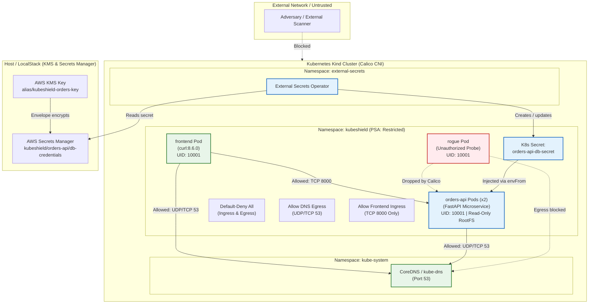

# KubeShield

**A production-grade reference architecture for multi-layered Kubernetes security and compliance.**

[](https://kubernetes.io/)
[](https://docs.tigera.io/calico/latest/about/)
[](https://external-secrets.io/)
[](https://localstack.cloud/)
[](https://kubernetes.io/docs/concepts/security/pod-security-standards/)
[](LICENSE)

KubeShield demonstrates defense-in-depth for a Kubernetes workload, from the network layer to the container runtime. Every control is codified as a manifest and verified by an automated test script.

| Layer | Control | Implementation |
| :--- | :--- | :--- |
| **Network** | Zero-trust microsegmentation | Calico CNI with default-deny ingress/egress, DNS allow-listing, and per-service ingress rules |
| **Identity** | Least-privilege RBAC | Dedicated ServiceAccounts, token automount disabled, read-only auditor, namespace-scoped deployer |
| **Secrets** | Envelope encryption & sync | AWS KMS + Secrets Manager (LocalStack for dev, IRSA for EKS) synced by External Secrets Operator |
| **Runtime** | Workload hardening | Pod Security Admission `restricted`, non-root UID, read-only root filesystem, all capabilities dropped, seccomp |
| **Compliance** | Continuous auditing | kube-bench (CIS), kubescape (NSA-CISA, MITRE ATT&CK), and a STRIDE threat model |

---

## Table of Contents

- [Architecture](#architecture)
- [Repository Structure](#repository-structure)
- [Prerequisites](#prerequisites)
- [Quickstart](#quickstart)
- [Phase 2: NetworkPolicy Verification](#phase-2-networkpolicy-verification)
- [Phase 3: RBAC Verification](#phase-3-rbac-verification)
- [Phase 4: Secrets Management with KMS and ESO](#phase-4-secrets-management-with-kms-and-eso)
- [Phase 5: Hardening and Compliance Audits](#phase-5-hardening-and-compliance-audits)
- [Threat Model](#threat-model)
- [Documentation](#documentation)
- [Cleanup](#cleanup)
- [License](#license)

---

## Architecture



---

## Repository Structure

```
KubeShield/
├── apps/
│   └── orders-api/                 # Hardened FastAPI microservice
│       ├── main.py                 # /healthz, /ready, /metrics, /api/v1/security-status, /api/v1/orders
│       ├── requirements.txt        # Pinned Python dependencies
│       └── Dockerfile              # Multi-stage, non-root, setuid-stripped image
├── deploy/
│   ├── kind/kind-calico.yaml       # 3-node Kind cluster with default CNI disabled
│   ├── cni/install-calico.sh       # Calico v3.28 installer
│   ├── namespaces/                 # PSA-labelled namespaces, default SA hardening
│   ├── rbac/                       # ServiceAccounts, auditor and deployer Roles
│   ├── network-policies/           # Default-deny, DNS egress, frontend -> orders-api
│   ├── apps/                       # orders-api Deployment/Service, frontend and rogue pods
│   └── external-secrets/           # LocalStack SecretStore, ExternalSecret, EKS IRSA ClusterSecretStore
├── localstack/init-scripts/        # Creates the KMS key and encrypted secret on LocalStack startup
├── security-scans/
│   ├── kube-bench/                 # CIS benchmark Job and sample report
│   └── kubescape/                  # NSA-CISA / MITRE ATT&CK scan runner
├── scripts/                        # Numbered setup and verification scripts (Bash + PowerShell)
├── docs/                           # Threat model, RBAC matrix, network, secrets, benchmarks
└── docker-compose.yml              # LocalStack (KMS + Secrets Manager)
```

---

## Prerequisites

| Tool | Purpose |
| :--- | :--- |
| [Docker](https://docs.docker.com/get-docker/) (with Compose v2) | Builds the image, runs Kind nodes and LocalStack |
| [kind](https://kind.sigs.k8s.io/docs/user/quick-start/#installation) | Local multi-node Kubernetes cluster |
| [kubectl](https://kubernetes.io/docs/tasks/tools/) | Cluster management |
| [Helm](https://helm.sh/docs/intro/install/) | Installs External Secrets Operator (Phase 4) |
| [kubescape](https://github.com/kubescape/kubescape) *(optional)* | Compliance scanning (Phase 5) |
| `curl`, `jq` *(optional)* | Health checks and pretty-printing |

> **Platform note:** The LocalStack `SecretStore` reaches the host through `host.docker.internal`, which resolves
> out of the box on Docker Desktop (Windows/macOS). On native Linux, point `endpoint` in
> [`localstack-secret-store.yaml`](deploy/external-secrets/localstack-secret-store.yaml) at an address reachable from the Kind nodes.
>
> On Windows, run the `.sh` scripts from Git Bash or WSL, or use the provided `.ps1` equivalents for the test phases.

---

## Quickstart

### 1. Provision the Kind cluster with Calico CNI

```bash
./scripts/01-setup-cluster.sh
```

Creates a 3-node Kind cluster with the default `kindnet` CNI disabled, installs **Calico v3.28**, and waits until all nodes are `Ready`.

### 2. Deploy workloads, RBAC, and NetworkPolicies

```bash
./scripts/02-deploy-all.sh
```

- Builds the hardened `orders-api` image (non-root UID 10001) and loads it into Kind.
- Creates the `kubeshield` namespace with `pod-security.kubernetes.io/enforce: restricted`.
- Disables ServiceAccount token automounting on default ServiceAccounts.
- Provisions `auditor-sa` and `deployer-sa` and binds their Roles.
- Applies the zero-trust NetworkPolicies.
- Deploys `orders-api` (2 replicas), the `frontend` client pod, and the `rogue` probe pod.

### 3. Run the verification phases

```bash
./scripts/03-test-network-policies.sh   # Phase 2
./scripts/04-test-rbac.sh               # Phase 3
./scripts/05-setup-localstack-secrets.sh # Phase 4
./scripts/06-run-security-audits.sh     # Phase 5
```

Each test script exits non-zero if any assertion fails, so it can be used as a CI gate.

---

## Phase 2: NetworkPolicy Verification

```bash
./scripts/03-test-network-policies.sh
# PowerShell:
powershell -ExecutionPolicy Bypass -File ./scripts/test-network-policies.ps1
```

**Authorized client: `frontend` → `orders-api:8000`**

```bash
kubectl exec -n kubeshield frontend -- curl -s -m 5 -w "\nHTTP_STATUS:%{http_code}\n" http://orders-api:8000/healthz
```
```text
{"status":"healthy","service":"orders-api","timestamp":1776000120.45}
HTTP_STATUS:200
```
**Result: ALLOWED** — matches the `allow-orders-api-ingress-from-frontend` rule on port 8000.

**Unauthorized client: `rogue` → `orders-api` (direct ClusterIP, bypassing DNS)**

```bash
ORDERS_IP=$(kubectl get svc orders-api -n kubeshield -o jsonpath='{.spec.clusterIP}')
kubectl exec -n kubeshield rogue -- curl -v -m 4 "http://${ORDERS_IP}:8000/healthz"
```
```text
*   Trying 10.96.142.88:8000...
* Connection timed out after 4001 milliseconds
curl: (28) Connection timed out after 4001 milliseconds
command terminated with exit code 28
```
**Result: BLOCKED** — Calico silently drops the SYN packets, so the connection times out.

**DNS egress**

```bash
# Authorized frontend resolves internal DNS
kubectl exec -n kubeshield frontend -- nslookup orders-api.kubeshield.svc.cluster.local
# -> resolves to the Service ClusterIP

# Rogue pod DNS queries are dropped by default-deny egress
kubectl exec -n kubeshield rogue -- nslookup -timeout=3 orders-api.kubeshield.svc.cluster.local
# -> ;; connection timed out; no servers could be reached
```

See [docs/network-security.md](docs/network-security.md) for the full policy walkthrough.

---

## Phase 3: RBAC Verification

```bash
./scripts/04-test-rbac.sh
# PowerShell:
powershell -ExecutionPolicy Bypass -File ./scripts/test-rbac.ps1
```

| Identity | Verb | Resource | Scope | Expected | Security Rationale |
| :--- | :--- | :--- | :--- | :---: | :--- |
| `auditor-sa` | `get` | `pods` | `kubeshield` | yes | Auditor inspects running pod health |
| `auditor-sa` | `list` | `deployments` | `kubeshield` | yes | Auditor reviews deployment configuration |
| `auditor-sa` | `get` | `networkpolicies` | `kubeshield` | yes | Auditor verifies firewall policies |
| `auditor-sa` | `get` | `secrets` | `kubeshield` | **no** | **Auditor cannot read secret payloads** |
| `auditor-sa` | `create` | `pods` | `kubeshield` | **no** | Read-only auditor cannot launch workloads |
| `auditor-sa` | `delete` | `deployments` | `kubeshield` | **no** | Read-only auditor cannot delete resources |
| `auditor-sa` | `get` | `nodes` | cluster | **no** | Auditor has no cluster-wide visibility |
| `deployer-sa` | `create` | `deployments` | `kubeshield` | yes | CI/CD releases new deployments |
| `deployer-sa` | `update` | `deployments` | `kubeshield` | yes | CI/CD updates configuration |
| `deployer-sa` | `delete` | `pods` | `kubeshield` | yes | Deployer can trigger pod restarts |
| `deployer-sa` | `get` | `secrets` | `kubeshield` | yes | Deployer validates secret existence |
| `deployer-sa` | `delete` | `secrets` | `kubeshield` | **no** | Deployer cannot delete synced secrets |
| `deployer-sa` | `create` | `clusterroles` | cluster | **no** | **Privilege escalation prevented** |
| `deployer-sa` | `create` | `deployments` | `default` | **no** | Deployer is confined to `kubeshield` |

See [docs/rbac-matrix.md](docs/rbac-matrix.md) for role definitions and design rationale.

---

## Phase 4: Secrets Management with KMS and ESO

```bash
./scripts/05-setup-localstack-secrets.sh
```

**Secrets flow**

1. **LocalStack** starts via `docker-compose.yml` on port 4566.
2. [`01-init-kms-secrets.sh`](localstack/init-scripts/01-init-kms-secrets.sh) creates a **KMS customer managed key** (`alias/kubeshield-orders-key`) and stores a **Secrets Manager** secret encrypted with it.
3. **External Secrets Operator** authenticates through the `SecretStore` and synchronizes the payload into the native Kubernetes Secret `orders-api-db-secret`.
4. `orders-api` consumes the credentials via `envFrom.secretRef`. The `/api/v1/security-status` endpoint confirms runtime ingestion without exposing the password:

```json
{
  "runtime": {
    "uid": 10001,
    "gid": 10001,
    "is_non_root": true,
    "read_only_rootfs": true,
    "tmp_storage_writable": true
  },
  "secrets": {
    "synced_from_external_secrets": true,
    "db_user_configured": "shield_admin",
    "db_password_masked": "P@***6!",
    "db_host": "postgres.kubeshield.svc.cluster.local",
    "db_name": "orders_db"
  },
  "pod_security_standard": "restricted"
}
```

> The credentials provisioned in LocalStack are throwaway demo values for a local emulator and grant access to nothing.

### Production: AWS EKS with IRSA

In EKS, static AWS credentials are eliminated entirely:

- The cluster's OIDC identity provider is associated with IAM.
- An IAM role trusts `sts:AssumeRoleWithWebIdentity`, scoped to `system:serviceaccount:external-secrets:external-secrets-irsa-sa`.
- The role's policy grants only `kms:Decrypt` and `secretsmanager:GetSecretValue` on specific ARNs.
- A [`ClusterSecretStore`](deploy/external-secrets/irsa-production-secret-store.yaml) uses `jwt.serviceAccountRef` to exchange projected tokens for short-lived STS credentials.

See [docs/external-secrets-irsa.md](docs/external-secrets-irsa.md) for the full production guide.

---

## Phase 5: Hardening and Compliance Audits

```bash
./scripts/06-run-security-audits.sh
```

Runs the kube-bench CIS benchmark Job in-cluster and, if installed, kubescape against the `deploy/` manifests (reports are written to `security-scans/kubescape/reports/`).

### Findings: Before vs. After Hardening

| Benchmark ID | Category | Risk | Baseline | Remediation | Hardened |
| :--- | :--- | :--- | :---: | :--- | :---: |
| CIS 5.2.6 / C-0013 | Identity | Containers running as root (UID 0) | High | `runAsNonRoot: true`, `runAsUser: 10001`, non-root image `USER` | Pass |
| CIS 5.2.1 / C-0017 | Filesystem | Writable container root filesystem | High | `readOnlyRootFilesystem: true`, size-limited `emptyDir` on `/tmp` | Pass |
| CIS 5.2.8 / C-0046 | Privilege | Default Linux capabilities retained | High | `capabilities.drop: ["ALL"]` | Pass |
| CIS 5.2.5 / C-0016 | Privilege | Privilege escalation permitted | High | `allowPrivilegeEscalation: false` | Pass |
| CIS 5.1.5 / C-0038 | Token | ServiceAccount token automounted | Medium | `automountServiceAccountToken: false` on SAs and pod specs | Pass |
| MITRE T1046 / C-0030 | Network | Flat cluster network | High | Calico default-deny with explicit allow-lists | Pass |
| MITRE T1552 / C-0057 | Secrets | Plaintext credentials in Git or ConfigMaps | Critical | KMS + Secrets Manager + External Secrets Operator | Pass |
| CIS 5.1.2 / C-0034 | RBAC | Over-privileged auditor reading Secrets | Medium | Read-only `auditor` Role that excludes `secrets` | Pass |
| PSA Restricted | Admission | Permissive Pod Security Standards | High | `pod-security.kubernetes.io/enforce: restricted` | Pass |
| Runtime Seccomp | Syscall | No system call filtering | Medium | `seccompProfile: { type: RuntimeDefault }` | Pass |

See [docs/hardening-benchmarks.md](docs/hardening-benchmarks.md) for details.

---

## Threat Model

Each control maps to a STRIDE category and MITRE ATT&CK technique:

| STRIDE | MITRE ATT&CK | Threat | KubeShield Mitigation | Verification |
| :--- | :--- | :--- | :--- | :--- |
| **Spoofing** | T1078 Valid Accounts | Stolen ServiceAccount token used to query the API server | Token automount disabled on SAs and pods; dedicated unprivileged SAs | `/var/run/secrets/kubernetes.io/serviceaccount` absent in pods |
| **Tampering** | T1611 Escape to Host | Overwriting binaries, installing tooling or rootkits | Read-only root filesystem; root-owned, read-only app files; `/tmp` `emptyDir` with size limit | `/api/v1/security-status` reports `read_only_rootfs: true` |
| **Repudiation** | T1070 Indicator Removal | Untraceable actions, log tampering | Structured JSON audit logs with trace ID, client IP, and UID; read-only auditor SA | Inspect pod stdout |
| **Information Disclosure** | T1552 Unsecured Credentials | Plaintext credentials in Git, ConfigMaps, or visible to auditors | KMS envelope encryption, Secrets Manager, ESO runtime sync; auditor denied `secrets` | `kubectl auth can-i get secrets --as=...auditor-sa` → `no` |
| **Denial of Service** | T1498 / T1499 Network & Endpoint DoS | Compromised pod scans or floods neighbouring services | Default-deny ingress/egress; ingress only from `frontend`; egress only to CoreDNS | `rogue` → `orders-api` times out |
| **Elevation of Privilege** | T1068 / T1611 | setuid binaries or kernel capabilities used to escape the container | PSA `restricted`; non-root; no privilege escalation; all capabilities dropped; seccomp `RuntimeDefault`; setuid bits stripped in image | Privileged pod creation rejected by admission |

See [docs/threat-model.md](docs/threat-model.md) for the complete analysis.

---

## Documentation

| Document | Contents |
| :--- | :--- |
| [Threat Model](docs/threat-model.md) | STRIDE and MITRE ATT&CK threat analysis |
| [RBAC Matrix](docs/rbac-matrix.md) | ServiceAccount design and `kubectl auth can-i` matrix |
| [Network Security](docs/network-security.md) | Calico NetworkPolicies and rogue pod blocking |
| [External Secrets & IRSA](docs/external-secrets-irsa.md) | LocalStack KMS integration and EKS IRSA production setup |
| [Hardening & Benchmarks](docs/hardening-benchmarks.md) | Pod Security Standards, kube-bench, and kubescape findings |

---

## Cleanup

```bash
kind delete cluster --name kubeshield
docker compose down -v
```

---

## License

Released under the [MIT License](LICENSE).
